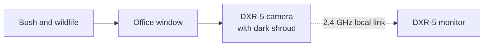
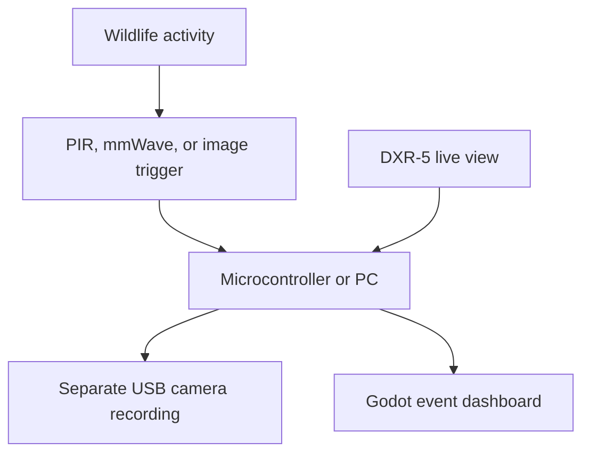

# Lab Proposal: DXR-5 Window Wildlife Observer

- **Status:** Proposed
- **Date:** 2026-11-05
- **Hardware:** Infant Optics DXR-5 camera, handheld monitor, camera stand, and two power adapters
- **Primary use:** Observe birds and small animals visiting the bush outside the office window
- **Project stage:** Discovery / feasibility

## Summary

Repurpose an existing Infant Optics DXR-5 baby monitor as a local, private wildlife observation system. The first iteration will preserve the hardware, establish whether its image is useful through the office window, and build a low-reflection window mount. Later iterations may add automatic event recording, pan/tilt control, a PC dashboard, or carefully documented video-interface reverse engineering.

The DXR-5 is a useful starting point because it is already a complete low-latency camera/display pair and does not require cloud service. Its limitations—low resolution, a small monitor, a proprietary local radio link, and infrared reflections from window glass—make this both a practical reuse project and a bounded electronics investigation.

## Goals

1. Obtain a stable live view of the target bush from inside the office.
2. Determine whether birds and small animals are recognizable at the expected distance.
3. Reduce daylight room reflections with a removable window shroud.
4. Preserve the original camera and monitor until the non-destructive approach is evaluated.
5. Define an incremental path to motion-triggered recording on a PC.
6. Document measurements and decisions so later reverse engineering is evidence-based.

## Non-goals for the first iteration

- Do not expose the camera or power adapter to weather.
- Do not assume the DXR-5 radio link can be received directly by a PC.
- Do not disassemble either unit before baseline testing is complete.
- Do not make nighttime observation through closed glass a first-iteration requirement.
- Do not replace the original camera merely to obtain a higher-resolution image; first determine what the existing system can do.

## Known system characteristics

These are working assumptions to verify against the labels and observed behavior of this specific unit.

| Characteristic | Working assumption | Project consequence |
| --- | --- | --- |
| Video link | Local proprietary 2.4 GHz digital/FHSS link | Private and convenient, but not expected to appear as a normal USB or Wi-Fi camera |
| Camera | VGA-class visible sensor with built-in infrared LEDs | Adequate for feasibility testing; fine detail may be limited |
| Monitor | Small handheld LCD receiver | Useful for live scouting; recording will need an additional path |
| Power | Camera and monitor adapters are nominally 6 V DC, approximately 1 A | Verify each label, connector size, and polarity before substituting power |
| Environment | Consumer indoor equipment | Camera, monitor, connectors, and adapters remain indoors |
| Night vision | Infrared LEDs surrounding the camera lens | Built-in IR is likely to reflect strongly from window glass |

## Proposed architecture

### Iteration 1: intact local observer

### Possible later recording system

The second architecture intentionally allows the DXR-5 to remain the low-latency scouting view while a better-supported camera performs recording. Direct extraction of DXR-5 video remains an optional investigation, not a dependency.

## Work plan

### Phase 0 — Inventory and safe power-up

- Photograph model, regulatory, and power labels on both units and both adapters.
- Match each adapter to its intended unit.
- Record output voltage, current rating, connector dimensions, and polarity.
- Inspect cables, strain reliefs, plugs, battery compartment, and enclosure condition.
- Power the camera and monitor on a nonflammable bench surface.
- Confirm pairing, stable video, control operation, audio behavior, and approximate battery runtime.
- Do not substitute a bench supply until polarity and current requirements are verified.

**Exit criterion:** The pair produces a stable live image for at least 30 minutes, or a specific failure mode is documented.

### Phase 1 — Window feasibility experiment

Place the camera indoors, facing the bush through a closed window. Test:

| Variable | Test conditions |
| --- | --- |
| Camera-to-glass distance | Approximately 0, 10, 30, and 100 mm |
| Room lighting | Off, normal, and deliberately bright |
| Shroud | None, temporary black card, and foam-sealed hood |
| Camera angle | Perpendicular and slightly oblique to the glass |
| Time | Morning, midday, dusk, and night |
| Infrared LEDs | Automatic/on as available, then temporarily masked for comparison |

For each test, record:

- ability to identify a bird-sized subject;
- visible room reflections;
- glare or flare;
- field of view and fraction occupied by the target bush;
- link stability;
- perceived latency;
- whether infrared light reflects from the glass;
- monitor photographs taken from a fixed distance for comparison.

**Decision gate:** If wildlife is too small to recognize, first move the camera closer to the target view or narrow the observed area. If that is insufficient, use the DXR-5 only as a scouting monitor and add a separate optical camera for useful capture.

### Phase 2 — Removable window shroud

Build a temporary prototype from black foam board, cardboard, removable tape, and soft foam. The shroud should:

- place the lens close to the glass;
- block light from the office;
- avoid pressing controls or blocking ventilation;
- mask the built-in IR emitters from the glass if necessary;
- allow quick camera removal;
- provide cable strain relief;
- leave no permanent adhesive on the camera or window.

**Exit criterion:** Reflections are visibly reduced without causing camera overheating or damaging the window finish.

### Phase 3 — 3D-printed mount

After measuring the successful temporary geometry, design a printable cradle with:

- adjustable tilt and optional pan;
- a replaceable black foam gasket;
- an IR-emitter cover or baffle;
- cable routing and strain relief;
- access to controls and fasteners;
- screw, clamp, or removable suction mounting;
- a design that does not rely on the camera enclosure as a structural fastener.

Prefer PETG if the mount will receive strong sunlight or window heat. Keep the prototype removable and inspect it periodically for softening or loss of adhesion.

**Deliverables:** CAD source, STL or 3MF export, photographs, and measured installation dimensions.

### Phase 4 — Event detection and PC recording

Evaluate these paths in order:

1. **Proof of concept:** Point an existing webcam or phone at the DXR-5 monitor and record the screen.
2. **Practical hybrid:** Use a separate USB camera aimed at the bush while retaining the DXR-5 as the instant live monitor.
3. **Triggered hybrid:** Add a PIR or mmWave sensor and an ESP32/RP2040 to signal recording software on the PC.
4. **Software trigger:** Use image-difference or object-detection software on the separate camera feed.
5. **Dashboard:** Create a small Godot interface showing the live or most recent capture, event time, notes, and a gallery of visitors.

A useful first PC milestone is not species recognition. It is a timestamped clip containing an actual animal with an acceptably low false-trigger rate.

### Phase 5 — Optional DXR-5 interface investigation

Only begin after the intact system has been tested and documented.

#### Receiver-first inspection

The handheld receiver is the preferred first teardown target because it already contains decoded image data. Document:

- all PCB markings and integrated-circuit part numbers;
- display connector and pin count;
- LCD controller or timing-controller markings;
- test pads and labeled serial interfaces;
- voltages with the unit off first, then powered only when a safe probing plan exists;
- whether the display interface appears to be parallel RGB, serialized RGB, composite video, or another format.

A logic analyzer or oscilloscope may reveal timing, but voltage levels must be identified before attaching test equipment.

#### Camera inspection

If receiver-side extraction is impractical, inspect the camera without removing components. Document the image sensor, ribbon cables, radio module, IR LED board, microphones, motors if present, and labeled test points. A direct sensor interface may require initialization commands, clocks, multiple power rails, and proprietary configuration; it is therefore an advanced branch rather than the default plan.

#### Stop rule

If obtaining PC video requires destructive changes, undocumented fine-pitch rework, or more effort than installing a supported USB camera, preserve the DXR-5 and use the hybrid architecture.

### Phase 6 — Optional pan/tilt wildlife station

If the camera base is mechanically suitable, add externally mounted micro servos controlled by an ESP32 or RP2040. Possible modes:

- joystick pan/tilt;
- saved bush locations;
- slow patrol;
- move-to-event position;
- manual control from a Godot dashboard.

Avoid repeatedly driving against mechanical stops, and route the power cable so motion cannot pull the adapter or camera from the window.

## Initial bill of materials

### Use what is already available

- DXR-5 camera and handheld monitor
- Original matched power adapters
- Black cardboard or foam board
- Soft black craft foam
- Removable painter's tape
- Ruler or calipers
- Phone camera for documenting monitor output

### Optional later additions

- PETG filament
- Removable suction cups, clamp, or command-style mounting hardware
- ESP32 or RP2040 development board
- PIR or mmWave presence sensor
- USB webcam with documented PC support
- Micro servos and a separate regulated servo supply
- Logic analyzer and oscilloscope probes appropriate to the measured logic voltage
- Outdoor-rated IR illuminator placed outside the glass, if nighttime observation becomes a requirement

## Risks and controls

| Risk | Control |
| --- | --- |
| Wrong adapter or polarity | Read and photograph labels; verify polarity with a multimeter before substitution |
| Infrared reflection from glass | Mask built-in IR at the glass; use outdoor illumination or make the first version daytime-only |
| Weather or condensation damage | Keep all DXR-5 hardware indoors |
| Window mount falls | Use redundant retention and strain relief; do not trust a single suction cup above fragile objects |
| Sunlight heats camera or printed mount | Monitor temperature; shade equipment; prefer PETG; remove the system if hot |
| Low resolution or wide field of view | Test recognizability before investing in automation |
| Proprietary video link blocks PC integration | Use a separate supported camera for recording |
| Teardown destroys a working system | Complete baseline tests, photographs, and connector maps first |
| False motion triggers | Begin with short observation sessions and tune placement, threshold, and cooldown |

## Success levels

- **Level 1 — Live view:** A bird or small animal can be recognized on the DXR-5 monitor from the intended office location.
- **Level 2 — Repeatable installation:** A removable mount provides a stable, low-reflection image for a full observation session.
- **Level 3 — Event capture:** The PC stores timestamped clips of real wildlife with a manageable false-trigger rate.
- **Level 4 — Integrated station:** A Godot dashboard provides recent events and optional positioning controls.
- **Level 5 — Reverse-engineering result:** The DXR-5 video path is characterized well enough to document a realistic capture interface, even if the final decision is not to implement it.

## First bench session checklist

- [ ] Photograph every label and connector.
- [ ] Confirm which adapter belongs to each unit.
- [ ] Verify adapter output and polarity.
- [ ] Confirm camera-to-monitor pairing.
- [ ] Run a 30-minute stability test.
- [ ] Measure the camera, stand, lens position, IR ring, and target window.
- [ ] Measure approximate camera-to-bush distance.
- [ ] Make a temporary black-card shroud.
- [ ] Capture comparison images with and without the shroud.
- [ ] Test built-in IR against the window at night without looking directly into the emitters.
- [ ] Decide whether the next step is mount design, a separate recording camera, or troubleshooting.

## Iteration 1 completion criteria

Iteration 1 is complete when:

1. the hardware and power configuration are documented;
2. the intact system has completed a stable 30-minute test;
3. window tests establish whether wildlife is recognizable;
4. a temporary shroud has been evaluated;
5. the next architecture is selected from:
   - DXR-5-only live observer;
   - DXR-5 plus separate PC recording camera;
   - receiver-side interface investigation;
   - stop and preserve as-is.

## Open questions

- What is the measured distance from the window to the usual bird locations?
- Does the specific camera permit disabling night vision, or must the IR LEDs be physically masked?
- Does the monitor expose any hidden A/V output, service connector, or accessible display bus?
- Is audio useful for bird activity detection?
- Is the target outcome live observation, archival clips, species logging, or all three?
- Should a future active project receive the next available stable `TODO-NNN` identifier and a machine-readable roadmap?
